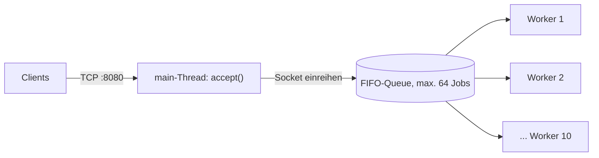
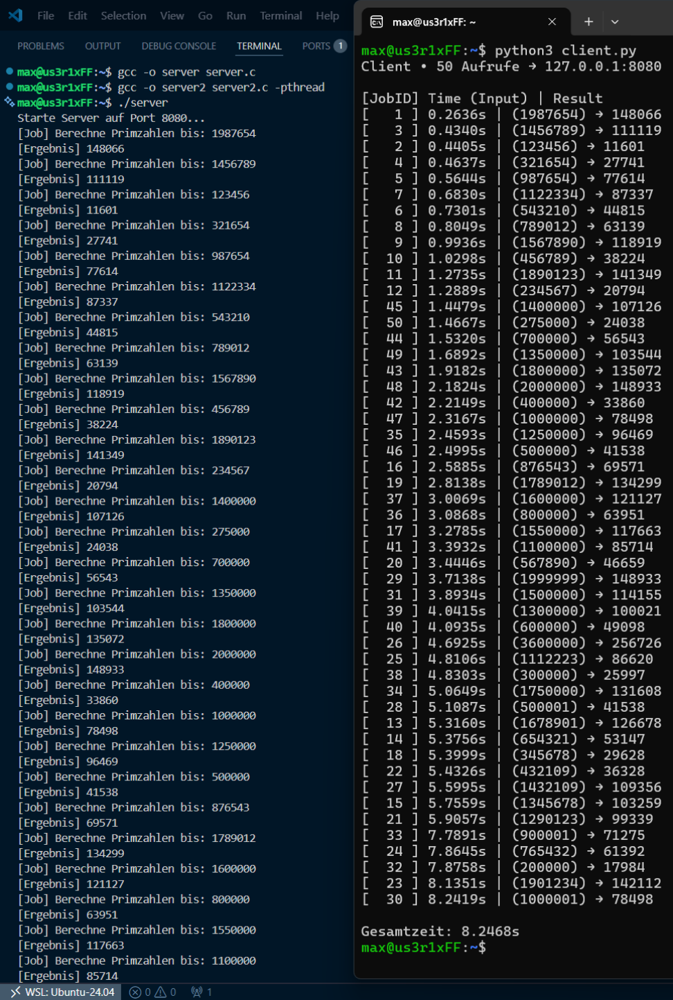
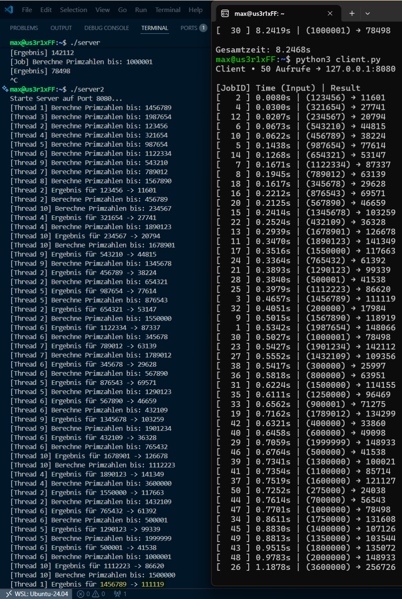

# Compute-Server

Ein TCP-Compute-Server in C, der für einen Client zählt, wie viele Primzahlen es von 0 bis zu einer übergebenen Grenze gibt. Entstanden als Praktikumsaufgabe 2 im Fach Betriebssysteme (Sommersemester 2026, Hochschule Albstadt-Sigmaringen).

Es gibt zwei Ausbaustufen: einen sequenziellen Server, der eine Anfrage nach der anderen bearbeitet, und einen Server mit Thread-Pool, der bis zu zehn Anfragen gleichzeitig rechnet.

## Dateien

| Datei | Inhalt |
|---|---|
| `server.c` | Teil 1: sequenzieller Server, alles läuft im main-Thread |
| `server2.c` | Teil 2: Thread-Pool mit 10 Worker-Threads und threadsicherer FIFO-Job-Queue (max. 64 Jobs) |
| `client.py` | Test-Client aus der Aufgabenstellung, schickt viele Anfragen parallel und misst die Antwortzeiten |
| `docs/` | Screenshots der Testläufe und ein Beispiel-Log des Thread-Pool-Servers |

## Voraussetzungen

Linux oder WSL mit `gcc` und Python 3. Der Server nutzt POSIX-Sockets und pthreads und läuft deshalb nicht direkt unter Windows.

## Kompilieren und starten

```bash
gcc -o server server.c
gcc -o server2 server2.c -pthread
```

Server starten (lauscht auf Port 8080, alle Netzwerk-Interfaces):

```bash
./server        # sequenziell
./server2       # mit Thread-Pool
```

In einem zweiten Terminal den Client starten:

```bash
python3 client.py 50
```

Das Argument ist die Anzahl paralleler Anfragen (Standard 50, höchstens 100). Der Server schreibt jede Aktion ins Terminal und in `log.txt` im aktuellen Verzeichnis. Beenden mit `Strg+C`.

## Protokoll

Der Client schickt die Obergrenze als Dezimalzahl mit abschließendem Zeilenumbruch, der Server antwortet mit der Anzahl der Primzahlen im Bereich 0 bis Grenze und schließt die Verbindung.

```
Client → Server:  1000000\n
Server → Client:  78498\n
```

## Umsetzung

### Teil 1: sequenzieller Server (`server.c`)

1. `socket()` legt einen TCP-Socket an, `SO_REUSEADDR` sorgt dafür, dass der Port nach einem Neustart sofort wieder frei ist.
2. `bind()` auf `INADDR_ANY:8080`, danach `listen()` mit einer Warteschlange von 10 Verbindungen.
3. In einer Endlosschleife nimmt `accept()` eine Verbindung an. Der Server liest per `recv()` Zeichen für Zeichen bis zum Zeilenumbruch, wandelt die Eingabe mit `atoi()` um und zählt die Primzahlen per Probedivision bis √n.
4. Das Ergebnis geht mit `send()` zurück, danach wird die Verbindung mit `close()` beendet.
5. Jeder Job und jedes Ergebnis wird im Terminal und in `log.txt` protokolliert.

Fehler bei `socket`, `bind`, `listen`, `accept` und `send` werden mit `perror()` gemeldet. Schlägt ein einzelnes `accept()` fehl, läuft der Server weiter.

### Teil 2: Thread-Pool (`server2.c`)

Der Code aus Teil 1 ist die Basis. Die Rechen- und Netzwerklogik ist in die Funktion `worker_thread()` gewandert, der main-Thread nimmt nur noch Verbindungen an und reiht den Client-Socket in die Queue ein.



- **Queue:** Ringpuffer `job_queue[64]` mit `q_head` (hier entnehmen die Worker), `q_tail` (hier fügt main ein) und `q_count`.
- **Synchronisation:** ein Mutex schützt die Queue. Zwei Condition Variables steuern das Warten:
  - `cond_not_empty`: Worker schlafen, solange die Queue leer ist, und werden von main beim Einreihen geweckt.
  - `cond_not_full`: main wartet, solange die Queue voll ist, und wird von einem Worker geweckt, sobald ein Platz frei wird.
- **Worker:** Jeder der 10 Threads nimmt einen Job nach dem FIFO-Prinzip, gibt den Lock wieder frei und bearbeitet die Anfrage komplett: Eingabe lesen, rechnen, Ergebnis senden, Verbindung schließen.
- **Logging:** `printf` und `fprintf` stehen ebenfalls unter dem Mutex, damit sich Zeilen verschiedener Threads in Terminal und Log-Datei nicht vermischen.

## Ergebnisse

Testlauf mit 50 parallelen Anfragen (Grenzen zwischen 123.456 und 3.600.000) unter WSL (Ubuntu 24.04):

| Server | Gesamtzeit des Clients |
|---|---|
| sequenziell (`server`) | 8,25 s |
| Thread-Pool (`server2`) | 1,26 s |

Beim sequenziellen Server warten die Anfragen aufeinander, die Antwortzeiten steigen deshalb Schritt für Schritt bis 8,24 s an. Mit Thread-Pool kam die letzte Antwort nach 1,19 s, und zwar für die größte Anfrage (3.600.000 → 256.726 Primzahlen).

**Sequenzieller Server** (links Server-Ausgabe, rechts Client):



**Server mit Thread-Pool:**



Fortsetzung der Ausgabe: [docs/server_threadpool_2.png](docs/server_threadpool_2.png), Log-Datei: [docs/beispiel_log.txt](docs/beispiel_log.txt)

## Fragen aus der Aufgabenstellung

**1. Warum ein Thread-Pool und kein Prozess-Pool? Was sind jeweils Vor- und Nachteile?**

Bei einem Prozess-Pool hätte jeder Prozess seinen eigenen Speicher. Damit alle auf dieselbe Warteschlange zugreifen können, müsste man erst gemeinsamen Speicher einrichten.

| | Vorteile | Nachteile |
|---|---|---|
| Thread-Pool | schnell, alle Threads teilen sich Adressraum und Warteschlange | ein Fehler in einem Thread kann den ganzen Server zum Absturz bringen |
| Prozess-Pool | Prozesse sind isoliert, ein fehlerhafter Prozess reißt den Server nicht mit | gemeinsame Speichernutzung ist aufwendiger und kostet mehr Ressourcen |

**2. Welchen Zeitvorteil bietet der Server mit 10 Threads gegenüber dem einthreadigen Server?**

Schätzung: Mit 10 Workern etwa ein Zehntel der Zeit, also rund 0,8 s statt 8,25 s.
Gemessen: 1,26 s statt 8,25 s. Das ist etwa 6,6-mal so schnell und spart rund 7 s, erreicht aber nicht ganz den Faktor 10. Gründe sind der zusätzliche Aufwand (Synchronisation, Verbindungsaufbau) und die unterschiedlich großen Jobs: Der größte Job (3.600.000) bestimmt am Ende die Gesamtzeit.

**3. Führt eine höhere Anzahl an Threads zu einer linear proportionalen Verbesserung?**

Nein. Wie viel gleichzeitig gerechnet werden kann, hängt von der CPU ab: Gibt es mehr Threads als Kerne, müssen sie sich die Kerne teilen. Das ist wie bei einem Filter: Wird der Filter größer, der Ablauf aber nicht, läuft das Wasser nicht schneller durch. Außerdem lassen sich manche Teile nicht parallelisieren, zum Beispiel das Annehmen der Verbindungen im main-Thread und der Zugriff auf Queue und Log, der über den Mutex nacheinander erfolgt.

**4. Was passiert, wenn die Job-Queue voll ist?**

Dann kann main keine neuen Anfragen mehr in den Puffer legen. In dieser Umsetzung blockiert main in `pthread_cond_wait(&cond_not_full, ...)` und nimmt keine weiteren Verbindungen an, bis ein Worker einen Job entnommen hat. Neue Verbindungen sammeln sich solange im Listen-Backlog des Betriebssystems (`listen(..., 10)`). Ist auch dieser voll, nimmt das Betriebssystem weitere Verbindungsversuche nicht mehr an, bis wieder Platz ist.

## Entstehung

Der Code ist im Rahmen des Praktikums entstanden. Diese Dokumentation wurde mit Hilfe von Claude (Anthropic) auf Basis der Abgabe erstellt.
